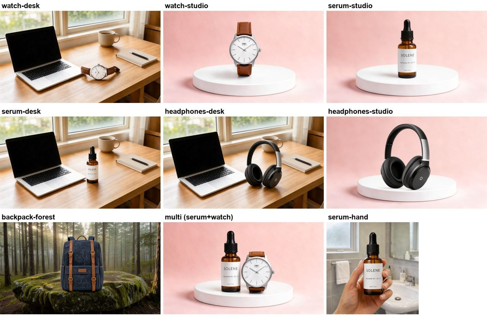
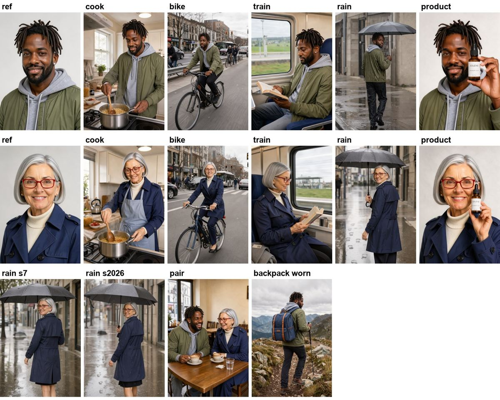
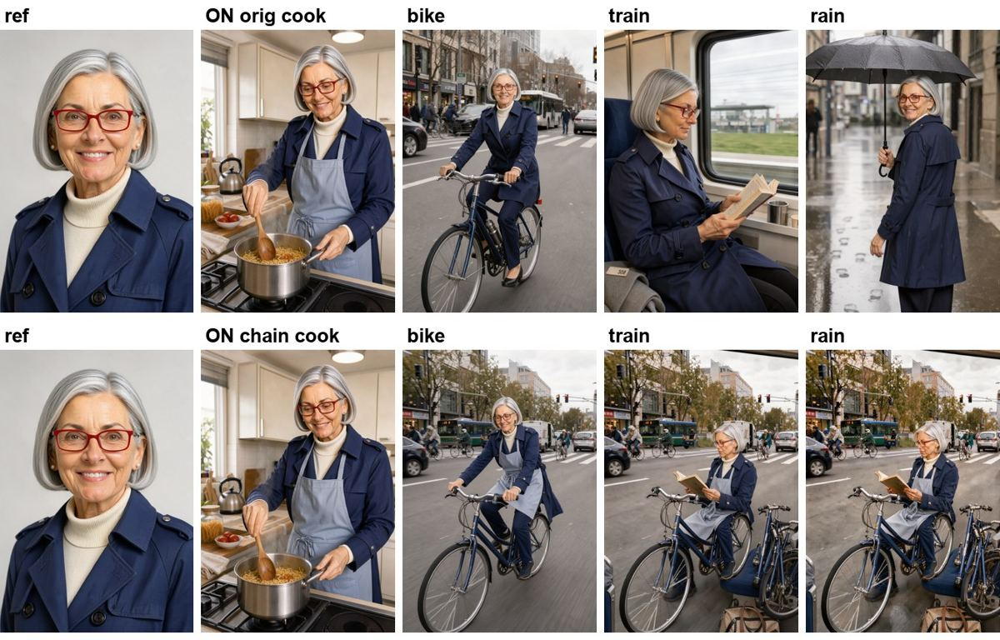
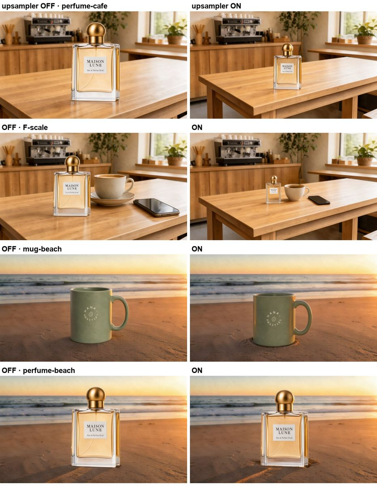

# 01. FLUX 3 Klein으로 상품 사진 합성하고 같은 인물로 여러 장면 만들기

- **상태:** 기존 실측 결과로 검증됨. 스크립트는 실험 스크립트를 옮겨 정리한 것이고, 그래프 생성 결과가 실험 때 실행한 API 그래프와 같은지 대조했습니다(아래 참고). **이 스크립트 그대로 새 Pod에서 처음부터 다시 돌려 보지는 않았습니다.**
- **검증일:** 2026-10-19 (UTC)
- **GPU:** NVIDIA L40S 48GB × 1, Runpod Secure Cloud
- **모델:** FLUX 3 Image Klein distilled (bf16), Qwen3-VL 4B 텍스트 인코더, Qwen3.5 9B 프롬프트 업샘플러, FLUX 2 VAE
- **출력:** 상품 4MP(약 2048×2048 상당), 인물 2MP, PNG

FLUX 3 Klein의 참조 이미지 편집으로 두 가지 실무 작업을 해 봅니다.

1. **상품 사진 합성**: 흰 배경 상품 사진 + 배경 사진 → 배경 위에 상품 올리기
2. **같은 인물로 여러 장면**: 인물 사진 한 장 → 요리, 자전거, 기차, 비 오는 길 등 다른 장면

ComfyUI 공식 템플릿과 같은 설정(distilled 16 step, CFG 1, 업샘플러 켬)에 **짧은 프롬프트 한 줄**만 쓰는 방식을 기준으로 했습니다. 시드 하나로 조건마다 1회씩 돌린 결과라 품질을 판정하는 벤치마크가 아닙니다.

## 결과 요약

| 작업 | 됐던 것 | 안 됐던 것 |
| --- | --- | --- |
| 상품 합성 | 노트북·컵이 있는 책상에서 크기가 자연스러움. 상품이 크게 보이는 컷(손에 든 컷, 손목 컷, 두 상품 컷)에서는 라벨의 작은 글자("Niacinamide 10% + Zinc 1%", "30 ml / 1 fl oz")와 시계 문자판 글자 유지. 손에 든 컷·손목 컷. 의자를 빈 거실에 놓기(시드 3개 모두 비슷) | 상품이 화면에서 작으면 작은 글자가 깨짐(책상 위 시계의 "ORBIT"). 크기를 비교할 물건이 없는 배경(받침대만 있는 스튜디오, 빈 해변)에서는 상품이 지나치게 큼. 상품 두 개를 같이 놓으면 둘 사이 크기가 틀림(시계가 30ml 병만 하게) |
| 같은 인물 | 사진 한 장으로 5장면 내내 얼굴·머리·안경·옷 유지. 뒷모습에서 돌아보기(시드 3개 모두). 두 사람 한 장면. 인물이 상품 들기·가방 메기 | **직전 결과를 다음 장면 참조로 넣으면(이어 쓰기)** 앞 장면의 옷·소품·배경이 계속 따라옴. 기차 장면이 자전거 위에서 책 읽는 모습으로 나옴 |







### 업샘플러를 꼭 켜 두세요

템플릿 기본값인 프롬프트 업샘플러(Qwen3.5 9B)는 사용자가 쓴 짧은 요청과 참조 이미지를 보고 긴 지시문을 다시 씁니다. 해상도를 키우는 업샘플링(Super Resolution)과는 다른 것으로, 픽셀이 아니라 프롬프트를 늘립니다. 14단어 요청("put the bottle from the first image on the desk in the second image")이 192단어 지시문이 됐고, 그 안에 "Match its scale to the laptop and mug" 같은 크기 지시가 들어갔습니다.

같은 프롬프트·시드에서 업샘플러만 끄고 켜 본 결과:

- 카페 테이블에 상품 올리기: 끄면 향수병이 화분만 하게, 켜면 테이블 위 작은 병 크기로 나옴
- 뒤에서 걸어가다 돌아보기: 끄면 카메라를 보고 선 사진, 켜면 지시대로 뒷모습
- 빈 해변에 상품 올리기: 켜도 여전히 큼



## 측정 결과

L40S 48GB, distilled bf16, 16 step, seed 42, 조건마다 1회. 시간은 `POST /prompt`부터 PNG 저장까지이며 업샘플러 문장 생성과 VAE 디코드가 들어 있습니다. 세션의 첫 실행에는 모델 로딩이 섞여 있어 따로 적었습니다.

| 작업 | 업샘플러 | 시간 |
| --- | --- | ---: |
| text-to-image 1MP (테스트 소재 만들기) | 끔 | 4.5–4.7초 |
| 상품 편집, 참조 2장 → 4MP | 켬 | 50.8–52.5초 (첫 장 56.1초) |
| 참조 1장 → 4MP (손에 든 컷, 손목 컷) | 켬 | 41.0–41.5초 |
| 참조 3장 → 4MP (상품 2개 + 배경) | 켬 | 63.1초 |
| 인물, 참조 1장 → 2MP | 켬 | 23.3–26.1초 |
| 인물 + 상품, 참조 2장 → 2MP | 켬 | 32.7–33.4초 |
| 상품 편집, 참조 2장 → 4MP | 끔 | 42.2–46.2초 |

상품 16장(시드 반복 포함)을 연속으로 돌린 GPU 시간은 13.4분, 시간당 $1.09로 계산하면 약 $0.24였습니다. Pod 부팅·셋업 시간과 실제 청구액은 들어 있지 않습니다.

### 빠르게 돌리는 설정 (업샘플러 끔, 참조 2장 → 4MP, 각 1회)

| 설정 | 시간 |
| --- | ---: |
| bf16, 16 step (기준) | 42.2초 |
| **int8-convrot**, 16 step | **23.4초** |
| bf16, 8 step | 22.3초 |
| bf16, 4 step | 13.1초 |
| bf16, 16 step, 출력 1MP | 16.7초 |

이 장면에서는 int8과 bf16 결과를 나란히 놓고 봐도 차이를 찾기 어려웠습니다(사람 눈으로 본 판단, 수치 비교 아님). 업샘플러를 켠 상태의 int8 시간은 재지 않았습니다.

개별 측정값은 [`evidence/results-summary.json`](evidence/results-summary.json)에 있습니다. `P-*`, `F-*`, `C-*`, `T-*`는 업샘플러를 끈 1차 실험, `U-*`는 같은 긴 프롬프트로 업샘플러만 켠 실험, `R2-*`는 업샘플러 켬 + 짧은 프롬프트, `UC-*`는 업샘플러 켠 이어 쓰기 실험입니다.

## 환경

| 항목 | 값 |
| --- | --- |
| Pod | L40S 48GB × 1, Secure Cloud (실험 당시 $1.09/h) |
| 컨테이너 이미지 | `runpod/pytorch:1.4.1-cu1300-torch291-ubuntu2404` |
| 디스크 | Container 120GB (모델 약 45GB + ComfyUI·가상환경) |
| 런타임 | Python 3.12.3, PyTorch 2.9.1+cu130 |
| ComfyUI | `v0.42.0` (`355cd6b14c92c19ac3188fe528e47a3f21ef5178`) |
| 모델 | `black-forest-labs/flux-3-image-klein-comfy` revision `feef60b0aaf63a4773ace96636ebbcf43b881312` |

셋업(Pod 부팅 후 ComfyUI 설치 + 모델 다운로드)은 약 5분이었습니다. 파일 하나당 다운로드 6–37초였습니다.

48GB를 고른 이유: 템플릿 그대로면 이미지 모델(11.1GB), 텍스트 인코더(8.9GB), 업샘플러(18.8GB)를 bf16으로 올립니다. 합치면 약 39GB입니다. ComfyUI는 메모리가 모자라면 모델을 내렸다 올리므로 24GB 카드에서도 돌 수는 있지만, 이 레시피에서는 재지 않았습니다.

## 라이선스와 입력

- **모델:** [FLUX Kommunity License v1.0](https://huggingface.co/black-forest-labs/flux-3-image-klein-comfy/blob/main/LICENSE.md). 비상업·비프로덕션 용도는 허용됩니다. 출력물을 상업적으로 쓰려면 계열사를 합한 연 매출이 **US$5,000,000 미만**인 Qualifying User여야 하고, 콘텐츠 필터링이나 공개 전 검토, 법이 요구하는 AI 생성 표시를 지켜야 합니다. 그 밖의 상업 이용은 BFL에 별도 라이선스를 받아야 합니다. 생체 정보 처리, 퍼블리시티권 침해 등 금지 용도도 원문에서 확인하세요.
- **gated 저장소:** Hugging Face에서 Klein 저장소가 두 개입니다. ComfyUI용 파일은 **`black-forest-labs/flux-3-image-klein-comfy`**에 있고, 라이선스 동의를 이 저장소에서 따로 해야 받을 수 있습니다(`flux-3-image-klein`에 동의해도 comfy 저장소는 열리지 않음).
- **업샘플러 시스템 프롬프트:** [`configs/upsampler-edit-system-prompt.txt`](configs/upsampler-edit-system-prompt.txt)는 같은 저장소 `workflows/flux3_klein_bf16_mi2i.json` 템플릿에서 가져왔습니다. 템플릿 파일은 Comfy Org의 MIT 라이선스입니다([`configs/LICENSE.upstream`](configs/LICENSE.upstream)).
- **입력 이미지:** 테스트용 상품·배경·인물 사진은 모두 이 레시피의 `materials` 단계에서 Klein으로 만드는 가상 이미지입니다. 저장소에 원본을 넣지 않았습니다. 실존 인물 사진이나 실제 브랜드 상품으로 바꿔 쓸 때는 권리를 직접 확인하세요.

## 1. Pod 만들기

Runpod 콘솔에서 L40S × 1, 위 컨테이너 이미지, Container 디스크 120GB로 Pod를 만듭니다. 이 레시피는 Pod를 자동으로 만들거나 지우지 않습니다. 가격은 만들기 직전에 콘솔에서 다시 확인하세요.

```bash
cd /workspace
git clone https://github.com/wlsdml1114/omg-runpod-media.git
cd omg-runpod-media/recipes/image/01-flux3-klein-product-character-edit
```

## 2. ComfyUI 설치와 모델 받기

먼저 Hugging Face에서 `black-forest-labs/flux-3-image-klein-comfy` 라이선스에 동의합니다. 토큰은 환경 변수로만 넘기고 파일이나 셸 기록에 남기지 마세요.

```bash
read -rs HF_TOKEN && export HF_TOKEN
python3 scripts/setup_pod.py      # WORK_ROOT 기본값 /workspace/klein
unset HF_TOKEN
```

스크립트는 ComfyUI `v0.42.0`을 받아 커밋을 확인하고, [`configs/model-manifest.json`](configs/model-manifest.json)의 5개 파일을 고정 revision으로 받아 SHA-256을 대조합니다. 받는 파일:

| 폴더 (`ComfyUI/models/`) | 파일 |
| --- | --- |
| `diffusion_models/` | `flux3-image-klein-bf16.safetensors`, `flux3-image-klein-int8-convrot.safetensors` |
| `text_encoders/` | `qwen3vl_4b_bf16.safetensors`, `qwen3.5_9b_flux3_prompt_upsampler_bf16.safetensors` |
| `vae/` | `flux2-vae.safetensors` |

## 3. 실행

`run_recipe.py`가 로컬 ComfyUI를 띄우고(이미 떠 있으면 그대로 사용) API로 그래프를 보냅니다. 결과는 `benchmark-output/<run_id>/`에 `out.png`, 실행한 `workflow.api.json`, 업샘플러가 쓴 `caption.txt`로 남고, 시간은 `benchmark-output/runs.jsonl`에 쌓입니다.

```bash
python3 scripts/run_recipe.py materials   # 테스트용 상품·배경·인물 12장 (text-to-image, seed 7)
python3 scripts/run_recipe.py products    # 상품 합성 12건 (2건은 seed 42/7/2026)
python3 scripts/run_recipe.py people      # 인물 2명 × 5장면 + 두 사람 1건
python3 scripts/run_recipe.py chain       # 이어 쓰기 실험
```

- 특정 항목만: `--ids R2-serum-desk R2-chair-living`
- 업샘플러 끄고 비교: `--no-upsampler` (결과 폴더가 겹치므로 `OUTPUT_DIR=...`를 다르게 주세요)
- int8 모델: `--model int8`

작업과 프롬프트는 [`configs/runs.json`](configs/runs.json)에 있습니다. 그래프는 [`scripts/klein_graph.py`](scripts/klein_graph.py)가 만듭니다. ComfyUI UI에서 직접 쓰려면 같은 설정의 공식 템플릿(`image_flux3_klein_distilled_image_edit` 또는 Hugging Face 저장소의 `workflows/flux3_klein_bf16_mi2i.json`)을 쓰면 됩니다. API 그래프 예시는 [`workflows/`](workflows/)에 있습니다.

### 템플릿과 같은 설정

| 항목 | 값 |
| --- | --- |
| 샘플러 | euler / simple, 16 step, CFG 1 (distilled는 CFG가 효과 없음) |
| ModelSamplingFlux | max_shift = base_shift = ln(16) ≈ 2.7726 |
| 참조 이미지 | ReferenceMultiLatent, 참조마다 1MP로 리사이즈 |
| 출력 크기 | 배경(마지막 참조) 비율로 4MP. 인물은 인물 사진 기준 2MP |
| 업샘플러 | TextGenerate, temperature 1, top_k 1, max_length 3584, thinking 끔. 참조 이미지를 순서대로 보여줌 |

실험 때 쓴 그래프는 업샘플러용 이미지를 한 번 더 불러오는 `LoadImage` 노드가 따로 있었습니다. 이 레시피는 같은 파일을 쓰는 노드를 하나로 합쳤고, 그 외 노드·값은 실험 그래프와 같습니다(`R2-serum-desk`, `R2-C2-woman-rain`, `UC-B-chain-bike`, `M2-watch`로 대조).

## 결과를 넓게 해석하면 안 되는 범위

- 조건마다 시드 하나, 1회 실행입니다. 성공·실패 장면이 시드 운일 수 있습니다(시드 3개를 돌린 것은 손목 시계, 의자, 비 오는 뒷모습뿐).
- 품질 판단은 사람이 시트를 보고 한 것이고 수치 지표가 아닙니다.
- 시간은 L40S 한 장, 이 해상도·스텝에서의 값입니다. 다른 GPU나 해상도로 옮길 수 없습니다.
- 이어 쓰기 실패는 두 인물, 각 한 번의 연쇄에서 본 것입니다. 업샘플러를 끈 1차 실험에서는 장면이 아예 바뀌지 않고 색·질감이 점점 망가졌고, 켠 실험에서는 앞 장면의 옷·소품·배경이 따라오는 식으로 실패했습니다.
- 업샘플러를 켠 상태의 int8, step 수 비교는 하지 않았습니다.

## 검증

```bash
python3 -m unittest discover -s tests -v
```

모델 없이 돌아가는 정적 검사입니다. manifest의 revision·SHA-256 형식, 그래프가 템플릿 설정(16 step, CFG 1, shift, 1MP 참조)과 맞는지, 예시 워크플로가 현재 그래프 생성기와 같은지, 스크립트에 비밀정보가 없는지 확인합니다.
